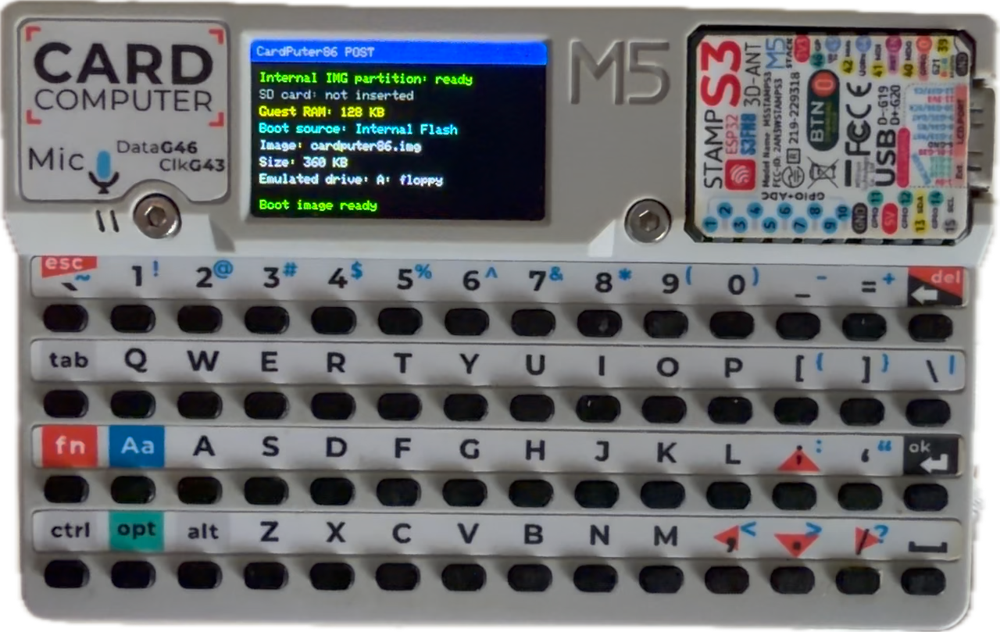
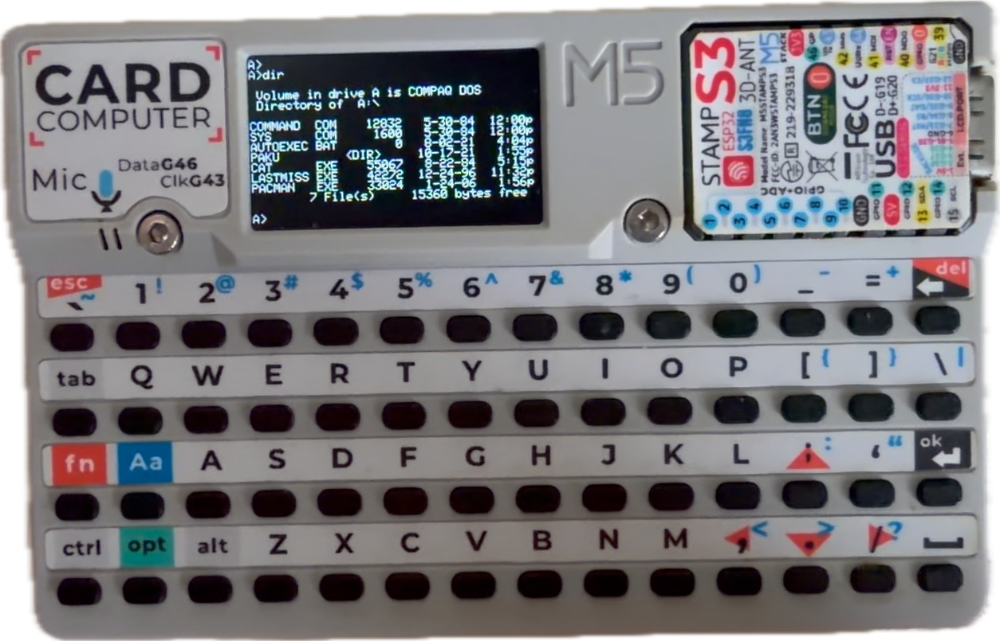

# CardPuter86-Plus

[中文](README.md) | **English**

An 8086 PC squeezed into an M5Stack Cardputer (ESP32-S3): it POSTs, boots real MS-DOS 5.0,
turns a whole microSD card into a DOS hard disk, and can flip itself into a Bluetooth keyboard.

> This is a derivative of [CardPuter86](https://github.com/Clearwavelet/CardPuter86)
> (by Clearwave, GPL), which in turn builds on
> [Fake86](https://github.com/mikechambers/fake86) and ESP32TinyFake86.
> Upstream provides the emulator skeleton, the BIOS/BASIC ROMs and the build flow.
> The additions here are concentrated in **storage, memory paging, keyboard, power
> management**, a dozen small DOS programs that actually run, and an **image packing tool**.

| POST | DOS |
| --- | --- |
|  |  |

---

## The three additions that matter

**1. A 1.44 MB MS-DOS 5.0 disk really boots.**
Upstream ships a 360 KB COMPAQ MS-DOS 2.11 image. 360 KB leaves under 100 KB free - not enough for
any tool set; 1.44 MB is. This fork makes guest RAM pageable in three sizes (128 / 256 / 512 KB);
256 KB clears MS-DOS 5.0's minimum, so a 1.44 MB system disk comes up and lands on `A:\>`.

**2. The SD card is DOS drive C: - a real block device, not a mounted image.**
The whole card is registered as raw hard disk `0x80`, so inside DOS you can run `FDISK`,
`FORMAT C:`, `MD`, `COPY`. You get whatever the card can address, capped by the INT 13h
1024x16x63 CHS limit at 504 MB.

**3. A packer: `tools/cp86img/cp86img.py`**
Point it at your own DOS boot disk and one command produces a CardPuter86 system disk with ten
programs on it. It parses the BPB instead of assuming a geometry, writes both FAT copies,
checks free space before writing a single byte, and **reads every file back for a byte-level
comparison**. See [docs/IMAGE.md](docs/IMAGE.md).

---

## Quick start

```sh
# 0) You need: M5Stack Cardputer, Python 3, PlatformIO Core, and your own DOS boot image.
#    (No MS-DOS is bundled - see "Why there is no DOS in here".)

# 1) Build a system disk from your own DOS floppy image
python3 tools/cp86img/cp86img.py build \
        --base   mydos.img \
        --out    ESP32/CardPuter86/data/cardputer86.img \
        --strip-installer

# 2) Build firmware and the filesystem image
cd ESP32/CardPuter86
pio run -e cardputer86-lean
pio run -t buildfs -e cardputer86-lean

# 3) Flash (--flash-mode MUST be dio)
esptool.py --chip esp32s3 --port /dev/ttyACM0 --baud 921600 write-flash \
  --flash-mode dio --flash-freq 80m --flash-size 8MB \
  0x10000  .pio/build/cardputer86-lean/firmware.bin \
  0x2A1000 .pio/build/cardputer86-lean/fatfs.bin
```

On Windows the flow is the same, only the port changes (`--port COM4`).
First boot reaches `A:\>` in roughly 30 seconds.

If you do not want to hunt for a DOS disk first: the bundled
`data/cardputer86.img` is the **360 KB COMPAQ MS-DOS 2.11 image published by upstream**, untouched.
It builds and boots as-is, but there is very little room on it.

---

## What changed versus upstream v0.5.0

Per `git diff`: 25 files, +3147 / -318 lines, plus two new files
(`cardputer_btkbd.cpp/.h`, about 430 lines).

| Area | Change |
| --- | --- |
| Guest memory | Runtime-selectable 128 / 256 / 512 KB in the settings menu, with internal flash as the swap backend; page table sized for 512 entries (512 KB needs 128 pages) |
| Storage | Multiple `*.img` files on internal flash; a new **Boot system** menu entry chooses which one boots next (remembered in NVS); the SD card is registered whole as raw block device `0x80` (C:); a 16-sector read-ahead window cut the SD transactions behind `dir c:` from 253 to 6 |
| Performance | `-O2` actually takes effect (`build_unflags` cancels the `-Os` PlatformIO appends); `IRAM_ATTR` on `read86/write86/exec86`; a hot-page cache for guest memory made 2000 instructions 25% cheaper |
| Stability | Fixed the TG0 task-watchdog reset loop (`yield()` maps to `vPortYield()`, which never lets the IDLE task run - now `vTaskDelay(1)` every 100 ms); fixed a 39-byte stack overflow in `cardputer_display.cpp` that any `-O2` build trips over the canary |
| Timing | Fixed an inverted unsigned subtraction in `timing.cpp` that made the 18.2 Hz timer interrupt fire at 1 kHz, and stopped `bootstrapPoll()` from overwriting the guest BIOS tick counter with second-granularity RTC data every millisecond (that froze every game loop) |
| Keyboard | Added the ten shifted number-row symbols (`!@#$%^&*()`) that `Aa` + digits produce; `handleinput()` now scans modifiers first in three passes; added a serial injection path so DOS can be driven remotely |
| Bluetooth | New BLE HID keyboard mode (`CardPuter86 KBD`), toggled from the settings menu and persisted in NVS; exit with **btnGO** on the back of the device, which reboots into DOS; includes a crash-loop guard |
| Power | New ESP32 core clock choice, 240 MHz or 80 MHz (persisted in NVS) |
| WiFi | The Hayes modem gained `AT&V`, `AT+WIFISCAN`, `AT+WIFI=ssid,pass`, `AT+HTTPGET`, `AT+CIFSR`, `AT+CIPCLOSE` |
| Tooling | New `tools/cp86img/cp86img.py` (image packing with byte-level verification) and ten DOS programs with sources under `apps/` |

---

## Honest notes on performance

- **The emulated CPU measures about 0.4 MIPS**, a little faster than an original 4.77 MHz
  IBM PC. The `4.77 / 8 / 10 / 12 / 16 / 24 / 33 / 80 MHz` entries in the settings menu are
  implemented by a throttle, and a throttle can **only slow the CPU down, never speed it up**.
  A batch of 2000 instructions already takes about 4.7 ms, which overshoots even the 4.77 MHz
  budget, so those entries behave identically today. Real speedups have to come from the
  interpreter - the giant `exec86` switch is the hot spot.
- **512 KB of guest RAM is slow.** Anything above 128 KB lives in internal flash: evicting one
  4 KB page costs about 50 ms (`wl_erase_range` + `wl_write` hit the physical erase floor),
  while reloading it costs 0.4 ms. At 512 KB the POST memory test takes minutes.
  **The default 256 KB** is the balance point between "it runs" and "it is usable".
- **One 8 KB SD transfer costs about 5 ms** (20 MHz SPI, roughly 1.7 MB/s). That is the bus limit.

## The SD card as C: - read this before you plug a card in

- At **boot** the firmware binds the card as raw sectors for drive C:; it does **not** parse
  the card's filesystem.
- You will run `FDISK` / `FORMAT` on C: from DOS, which **destroys every partition and file
  already on the card**. Back it up first, or dedicate a card to this.
- Once the card is C:, the firmware no longer reads its filesystem, so **"put a .img on the SD
  card and boot from it" does not work while a card is inserted**. For multi-boot, keep several
  `*.img` files on internal flash (fatfs) and switch with **Boot system** in the settings menu.
- After heavy writing plus repeated hard resets the card can wedge; only a **long-press power
  cycle** clears it - unplugging USB does not remove power from the card, because the device
  has a battery.
- The SD card uses SPI2 (SPI3 belongs to the display stack); pins live in
  `ESP32/CardPuter86/CardPuter86/hardware.h`.

## Hardware and constraints

- **Board**: M5Stack Cardputer (ESP32-S3, 8 MB flash, ST7789 240x135).
- **Display**: text mode uses a 40x16 character viewport (6x8 cells, written straight to `0xB8000`).
- **Keyboard**: WASD is direct, arrows are `Fn` + `; , . /`, `Fn` + `` ` `` is Esc.
  Do not poll with `kbhit()`; reading the BDA at `0x0040001A / 0x0040001C` is reliable.
- **The trap for guest programs**: a real BIOS `INT 16h` returns **AH = scan code, AL = ASCII**.
  Compare AL for ordinary characters - comparing the whole AX never matches
  (this project walked into that three separate times).
- **In DOS, `.COM` wins over `.EXE`**: with both `FOO.COM` and `FOO.EXE` on the disk, `FOO.COM` runs.
- **Names must be 8.3**: a base name longer than 8 characters gets truncated and DOS answers
  `Bad command or file name`. The packer rejects such names instead of truncating them.

## Repository layout

```
ESP32/CardPuter86/           PlatformIO project (firmware + system disk under data/)
  CardPuter86/               emulator and board code (cpu / disk / video / guest_memory / ...)
  data/cardputer86.img       boot disk baked into the flash filesystem
tools/cp86img/cp86img.py     the image packer (stdlib only, single file)
tools/cp86img/apps/          ten DOS programs (.EXE/.COM), sources in apps/src/
tools/dos/                   upstream DOS-side helpers
tools/ima2h/                 upstream ROM / font conversion tool
docs/IMAGE.md                image packing guide (bilingual)
docs/BUILD.md                build and flash guide (bilingual)
docs/README-upstream*.md     upstream READMEs, kept for reference
NOTICE.md                    provenance and credits
```

## Bundled DOS programs

In `tools/cp86img/apps/`, sources in `apps/src/`, all rebuildable with Digital Mars
`dmc -msd -w`:

| Program | Size | What it is |
| --- | --- | --- |
| `MINIGAME.EXE` | 40,264 | Seven games: snake / minesweeper / gomoku / tetris / pac-man / dino run / maze |
| `MARIO.EXE` | 16,236 | 40x16 text-mode Mario: 120-column scrolling world, stomping, coins, flag |
| `TE.EXE` | 45,216 | Text editor: direct VRAM writes, soft wrap, `^O` saves, `^X` quits |
| `WTERM.EXE` | 13,278 | COM1 terminal for the firmware's Hayes / WiFi modem |
| `ASM.EXE` | 44,638 | 8086 assembler |
| `DIAG.COM` | 13,748 | Boot diagnostics (A20 / timer / video / interrupt table) |
| `SNAKE.EXE` / `G2048.EXE` / `MINE.EXE` | - | Earlier single-game builds |
| `KEYDBG.EXE` | 12,848 | Key code viewer (prints AX / al / ah) |

## Why there is no DOS in here

MS-DOS is Microsoft's copyrighted work (COMPAQ MS-DOS 2.11 is Microsoft's OEM release for COMPAQ).
Redistributing it from a public
repository is unauthorised distribution: it invites a DMCA takedown and can put the account at
risk. Therefore:

- This repository **adds no DOS system files**. `data/cardputer86.img` is exactly the
  360 KB COMPAQ MS-DOS 2.11 image upstream publishes, unmodified.
- For a 1.44 MB MS-DOS 5.0 / 6.22 disk, use an image you legitimately own (a physical floppy,
  your own backup, or the open-source FreeDOS) and run `cp86img.py build`. The tool only adds
  and removes files; it never touches the DOS boot sector or the system files.

## Licence and credits

- Same licence as upstream: **GNU General Public License**, see [LICENSE](LICENSE).
- Provenance: Fake86 (Mike Chambers) -> ESP32TinyFake86 -> CardPuter86 (Clearwave) -> this fork.
  See [NOTICE.md](NOTICE.md).
- The DOS program sources under `apps/` are new here and are released under the same GPL.
- `tools/cp86img/cp86img.py` is a new, independent tool.
