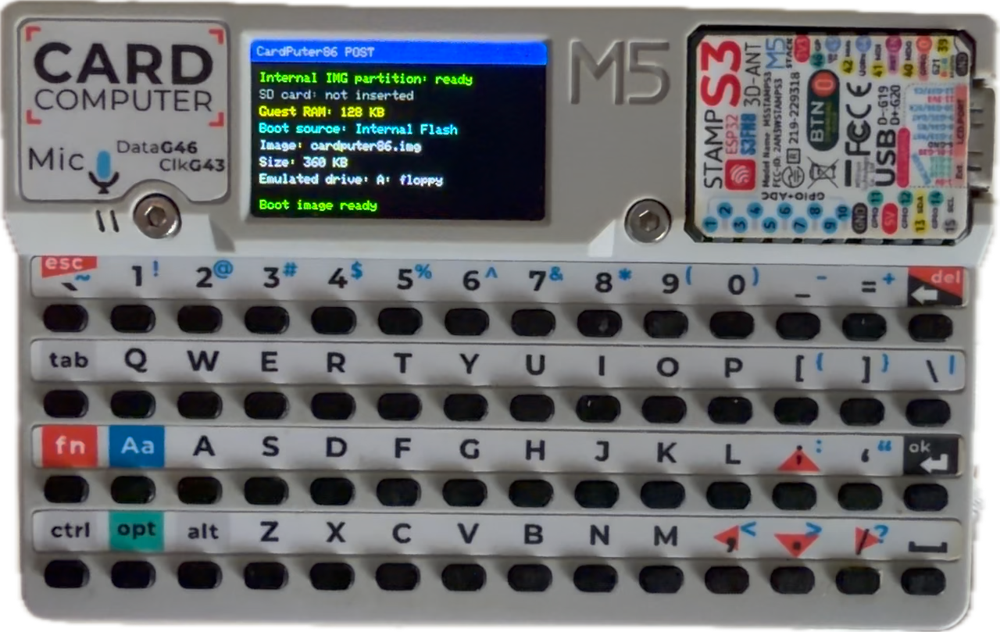
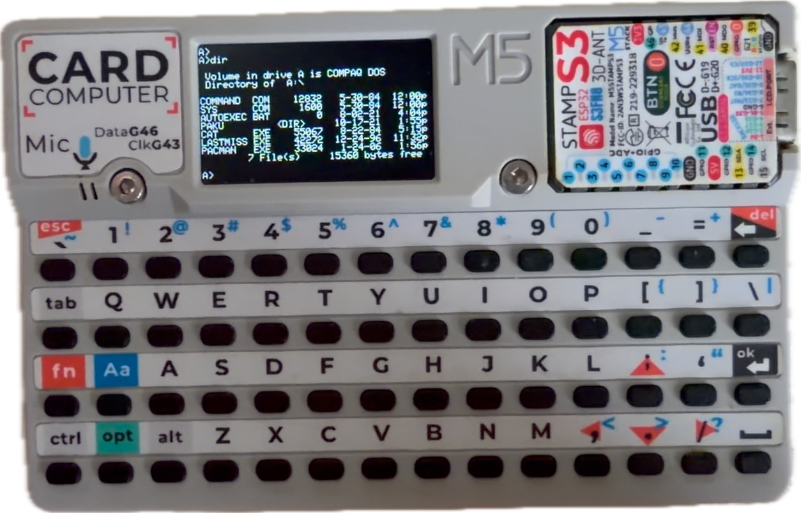

# CardPuter86-Plus

**中文** | [English](README.en.md)

把一台 8086 PC 塞进 M5Stack Cardputer（ESP32-S3）：开机进 POST、跑真正的 MS-DOS 5.0、
SD 卡整张当 DOS 硬盘、需要时还能反手变成一个蓝牙键盘。

> 本仓库是 [CardPuter86](https://github.com/Clearwavelet/CardPuter86)（作者 Clearwave，GPL）
> 的派生版，后者基于 [Fake86](https://github.com/mikechambers/fake86) 与 ESP32TinyFake86。
> 上游提供了模拟器骨架、BIOS/BASIC ROM 和构建流程；本仓库的增量集中在**存储、内存分页、
> 键盘、电源管理**，以及十几个能在 DOS 下真正跑起来的小程序和一个**镜像打包工具**。

| POST | DOS |
| --- | --- |
|  |  |

---

## 三个最有用的增量

**1. 1.44MB 的 MS-DOS 5.0 真的能启动**
上游带的是 360KB 的 COMPAQ MS-DOS 2.11。360KB 只剩不到 100KB 空间，装不下任何成套工具；
1.44MB 才够。本仓库把 guest RAM 做成可分页的 128/256/512KB 三档，256KB 正好跨过
DOS 5.0 的最低要求，于是 1.44MB 系统盘能起来并落到 `A:\>`。

**2. SD 卡 = DOS 的 C: 硬盘（不是只读镜像挂载）**
整张卡作为裸块设备注册成 `0x80` 硬盘，DOS 里可以 `FDISK`、`FORMAT C:`、`MD`、`COPY`。
卡上有多少空间就给多少（受 INT 13h 的 1024×16×63 CHS 上限约束，最大 504MB）。

**3. 打包工具 `tools/cp86img/cp86img.py`**
拿你自己的 DOS 启动盘，一条命令生成带 10 个程序的 CardPuter86 系统盘。
它按 BPB 解析几何、只往两份 FAT 写、分配前先算空间、写完**逐字节回读校验**。
详见 [docs/IMAGE.md](docs/IMAGE.md)。

---

## 快速开始

```sh
# 0) 准备：M5Stack Cardputer、Python 3、PlatformIO Core、以及你自己的 DOS 启动镜像
#    （本仓库不附带 MS-DOS，理由见"为什么没有附带 DOS"）

# 1) 用你自己的 DOS 盘生成系统盘，输出直接落到工程的数据目录
python3 tools/cp86img/cp86img.py build \
        --base   mydos.img \
        --out    ESP32/CardPuter86/data/cardputer86.img \
        --strip-installer

# 2) 构建固件 + 文件系统镜像
cd ESP32/CardPuter86
pio run -e cardputer86-lean
pio run -t buildfs -e cardputer86-lean

# 3) 刷写（--flash-mode 必须是 dio）
esptool.py --chip esp32s3 --port /dev/ttyACM0 --baud 921600 write-flash \
  --flash-mode dio --flash-freq 80m --flash-size 8MB \
  0x10000  .pio/build/cardputer86-lean/firmware.bin \
  0x2A1000 .pio/build/cardputer86-lean/fatfs.bin
```

Windows 上是同一个流程，串口换成 `--port COM4`。第一次开机约 30 秒进 `A:\>`。

不想自己找 DOS 也能立刻跑起来：仓库自带的 `data/cardputer86.img` 是**上游随仓库发布的
360KB COMPAQ MS-DOS 2.11 镜像**，直接构建就能开机，只是空间很小。

---

## 相对上游 v0.5.0 改了什么

`git diff` 口径：25 个文件、+3147 / −318 行，另有 2 个新文件
（`cardputer_btkbd.cpp/.h`，约 430 行）。要点：

| 方向 | 改动 |
| --- | --- |
| guest 内存 | 新增 128 / 256 / 512KB 三档运行期可选（设置菜单），内部 flash 当 swap 后端；页表 512 项上限，512K 需要 128 页 |
| 存储 | 内部 flash 支持多张 `*.img`；新增「Boot system」菜单选择下次启动哪个镜像（NVS 记忆）；SD 卡整卡注册为 `0x80` 裸块设备（C:）；读盘加 16 扇区预读窗口（`dir c:` 的 SD 事务从 253 次降到 6 次） |
| 性能 | `-O2` 真正生效（用 `build_unflags` 顶掉 PlatformIO 追加的 `-Os`）；`read86/write86/exec86` 加 `IRAM_ATTR`；guest 内存热页缓存让每 2000 条指令耗时降 25% |
| 稳定性 | 修掉 TG0 任务看门狗复位循环（`yield()`=`vPortYield()` 喂不到 IDLE 任务，改成每 100ms `vTaskDelay(1)`）；修掉 `cardputer_display.cpp` 的 39 字节栈溢出（-O2 下必踩 canary） |
| 定时 | 修掉 `timing.cpp` 里被写反的无符号差值（原先让 18.2Hz 的定时器中断跑成 1kHz），以及 `bootstrapPoll()` 每毫秒用 RTC 覆盖客户机 BIOS 计时器导致游戏主循环卡死 |
| 键盘 | 补齐 `Aa+数字键` 的十个 shift 符号（`!@#$%^&*()`）；`handleinput()` 改成修饰键优先的三趟扫描；新增串口注入通道（可远程敲 DOS） |
| 蓝牙 | 新增 BLE HID 键盘模式（`CardPuter86 KBD`），开关在设置菜单且掉电保持；按机身背面 **btnGO** 退出并重启进 DOS；带崩溃循环自愈 |
| 电源 | 新增 ESP32 主频 240MHz / 80MHz 可选（NVS 记忆） |
| WiFi | Hayes modem 的 AT 命令集扩充：`AT&V`、`AT+WIFISCAN`、`AT+WIFI=ssid,pass`、`AT+HTTPGET`、`AT+CIFSR`、`AT+CIPCLOSE` |
| 工具 | 新增 `tools/cp86img/cp86img.py`（镜像打包，带字节级校验）、`apps/` 里 10 个 DOS 程序和它们的源码 |

---

## 关于性能（说实话）

- **模拟 CPU 实测约 0.4 MIPS**，比原版 4.77MHz IBM PC 略快一点。
  设置菜单里的 `4.77 / 8 / 10 / 12 / 16 / 24 / 33 / 80 MHz` 档位由节流器实现，
  而节流器**只能放慢、不能加快**；实测每批 2000 条指令耗时约 4.7ms，已经超出
  4.77MHz 的时间预算，所以这些档位在当前固件下行为等价。想更快只能从解释器本身下手
  （`exec86` 的巨型 switch 才是热点）。
- **512KB guest RAM 很慢**。超过 128KB 的部分靠内部 flash 换页：实测**换出一页 4KB
  约需 50ms**（`wl_erase_range` + `wl_write` 的物理擦除下限），读回只要 0.4ms。
  512KB 下 POST 的内存测试要以分钟计。**默认 256KB** 是能用与好用之间的平衡点。
- **SD 卡单次 8KB 传输约 5ms**（20MHz SPI，约 1.7MB/s），这是 SPI 总线的硬顶。

## 关于 SD 卡作为 C:（会动你的卡，务必先看）

- 固件在**启动时**把 SD 卡按裸扇区挂成 C: 硬盘，**不解析卡上的文件系统**。
- 你会在 DOS 里对 C: 做 `FDISK` / `FORMAT`，**卡上原有的分区表和文件会全部丢失**。
  要保留卡里的照片或文件，请先备份，或者换一张专用卡。
- 卡被注册为 C: 之后，固件就不再读卡上的文件系统，所以**「把 .img 放 SD 卡当启动盘」
  在插卡状态下不可用**；多系统启动请用内部 flash（fatfs）里的多张 `*.img`，
  通过设置菜单的 **Boot system** 切换。
- 卡改到坏状态（大量写入 + 反复硬复位后偶发）需要**长按电源键彻底断电**才能恢复；
  拔插 USB 不会给卡断电。
- SD 走 SPI2（SPI3 被显示栈占用）；引脚见 `ESP32/CardPuter86/CardPuter86/hardware.h`。

## WiFi 与内存（二选一的实话）

2026-11 起 lean 构建**默认就带 WiFi**（Hayes modem 打到 COM1），开机自动关联
NVS 里存的 AP。但 ESP32-S3 只有 ~320 KB 内部 SRAM，`exec86` 的页缓存、320×200
显示帧缓冲（62.5 KB）、内部盘 FatFS、WiFi/lwIP 四方抢的是同一块。实测（dbglean 的
`[mem]` 打点）：

| 状态 | guest 常驻页 | 说明 |
|---|---|---|
| WiFi 关（菜单里 Network COM1 = Disabled） | 12–20 页 | DOS 最快，`c:` ≈ 2–3.5 ms/批 |
| WiFi 开（已关联） | 6–8 页 | 换页变多，射频还会插进 `exec86` 空档 |

**128 KB 档**（Guest RAM 菜单）刻意保留了 128 KB 机器，但凑不满 32 页（131,072 B）
就退化成「128 KB + 换页」，而不是悄悄变成 256 KB —— 屏幕会写
`128 KB RAM (paging, SRAM short)`。128 KB 跑 DOS 2.11 有意义，跑 DOS 5.0 装不下。

想两头都要，就按用途切换：玩 DOS 时把 WiFi 关掉，需要联网/拨号时再打开。

## 硬件与限制

- **主板**：M5Stack Cardputer（ESP32-S3，8MB flash，ST7789 240×135）。
- **显示**：文本模式走 40×16 字符视口（每字符 6×8，直写 `0xB8000`）。
- **键盘**：物理键盘 WASD 直用，方向键是 `Fn`+`; , . /`，`Fn`+`` ` `` 是 Esc。
  判断按键不要用 `kbhit()`，读 BDA 的 `0x0040001A / 0x0040001C` 更可靠。
- **写给 guest 程序的坑**：真 BIOS 的 `INT 16h` 返回 **AH=扫描码、AL=ASCII**。
  判断普通字符一律比较 AL，比较整个 AX 会永远不成立（本项目为此踩过三次）。
- **DOS 里 `.COM` 优先于 `.EXE`**：盘上同时有 `FOO.COM` 和 `FOO.EXE` 时跑的是 `.COM`。
- **文件名必须 8.3**：超过 8 字符的主名会被截断，然后 DOS 报
  `Bad command or file name`。打包工具会直接拒绝这种名字而不是截断。

## 仓库结构

```
ESP32/CardPuter86/           PlatformIO 工程（固件 + data/ 里的系统盘）
  CardPuter86/               模拟器与板级代码（cpu / disk / video / guest_memory / …）
  data/cardputer86.img       构建 fatfs 时打进 flash 的启动盘
tools/cp86img/cp86img.py     ★ 镜像打包工具（纯标准库，单文件）
tools/cp86img/apps/          ★ 10 个 DOS 程序（.EXE/.COM），源码在 apps/src/
tools/dos/                   上游的 DOS 端小工具
tools/ima2h/                 上游的 ROM / 字模转换工具
docs/IMAGE.md                ★ 镜像怎么打包（中英双语）
docs/BUILD.md                ★ 怎么构建和刷写（中英双语）
docs/README-upstream*.md     上游原始 README（留档）
NOTICE.md                    来源与致谢
```

## 随仓库附带的 DOS 程序

在 `tools/cp86img/apps/`，源码在 `apps/src/`，都可以用 Digital Mars 的
`dmc -msd -w` 重新编译：

| 程序 | 大小 | 说明 |
| --- | --- | --- |
| `MINIGAME.EXE` | 40,264 | 七合一：贪吃蛇 / 扫雷 / 五子棋 / 俄罗斯方块 / 吃豆人 / 小恐龙 / 走迷宫 |
| `MARIO.EXE` | 16,236 | 40×16 文本版超级马里奥（120 列滚动世界、踩敌人、金币、旗子） |
| `TE.EXE` | 45,216 | 文本编辑器，直写显存、软换行、`^O` 存盘 `^X` 退出 |
| `WTERM.EXE` | 13,278 | COM1 终端，配合固件的 Hayes / WiFi modem 用 |
| `ASM.EXE` | 44,638 | 8086 汇编器 |
| `DIAG.COM` | 13,748 | 启动诊断（A20 / 定时器 / 视频 / 中断表） |
| `SNAKE.EXE` / `G2048.EXE` / `MINE.EXE` | — | 早期单游戏版本 |
| `KEYDBG.EXE` | 12,848 | 键码查看器（打印 AX/al/ah） |

## 为什么没有附带 DOS

MS-DOS 是微软的版权作品（COMPAQ MS-DOS 2.11 是微软授权给 COMPAQ 的 OEM 版）。把它传到公开仓库属于未授权分发，
会被 DMCA 下架，还可能牵连账号。所以：

- 本仓库**没有新增任何 DOS 系统文件**。`data/cardputer86.img` 就是上游随仓库发布的
  那张 360KB COMPAQ MS-DOS 2.11 镜像，原样未改。
- 想要 1.44MB 的 MS-DOS 5.0 / 6.22：用你自己合法拥有的软盘镜像（实体盘、自己的备份、
  或开源替代品 FreeDOS 都可以），然后跑 `cp86img.py build`。工具只做文件级的增删，
  **不修改 DOS 的引导扇区和系统文件**。

## 许可与致谢

- 本仓库沿用上游许可：**GNU General Public License**，见 [LICENSE](LICENSE)。
- 来源链：Fake86（Mike Chambers）→ ESP32TinyFake86 → CardPuter86（Clearwave）→ 本仓库。
  详见 [NOTICE.md](NOTICE.md)。
- `apps/` 里的 DOS 程序源码为本仓库新增，同样按 GPL 发布。
- `tools/cp86img/cp86img.py` 为新增的独立工具。
